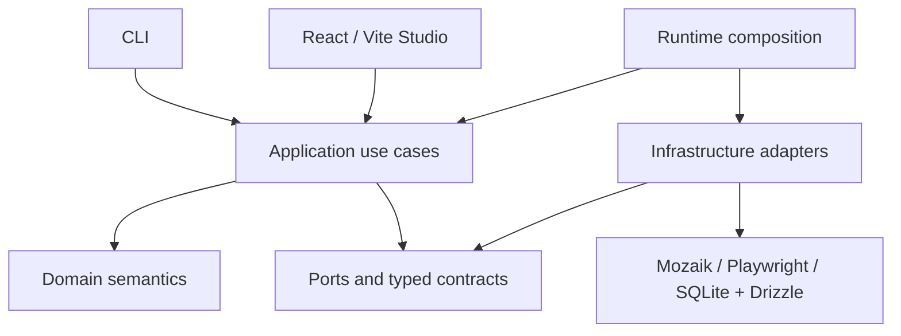

# Architecture

Read [PROJECT.md](PROJECT.md) for product semantics and implementation status.

## Confirmed direction

- TypeScript and Node.js, managed with npm without npm Workspaces.
- A CLI plus the existing React/Vite Studio. Do not relocate the CLI or restructure Studio without explicit authorization.
- Internal modular code under `packages/`, with hexagonal boundaries and dependency inversion where meaningful. Directories outside the implemented domain and contracts remain provisional scaffolding, not a finalized package design.
- Mozaik for concurrent multi-agent coordination and Playwright for browser automation.
- SQLite with Drizzle for local persistence. Fastify provides the initial protected local health interface; simulation-control HTTP and Studio transport remain deferred.
- Typed semantic events and shared state for coordination and visibility.
- Explicit security policy enforcement and investigation/evidence management.
- Runtime composition connecting application behavior to replaceable infrastructure adapters.

The root package now pins @mozaik-ai/core 4.2.0, integrated through packages/orchestration against a controlled local fixture. SQLite persistence now uses exact root dependencies drizzle-orm 0.45.4 and better-sqlite3 13.0.3, with versioned migrations. Fastify 5.12.7 is installed for the local host. Playwright remains uninstalled; real browser integration is deferred.

## Dependency direction and responsibilities

Domain logic owns exploration and evidence semantics without importing browser, database, UI, orchestration-library, or model-provider implementations. Application use cases coordinate domain behavior through explicit ports where external capabilities are needed. Infrastructure implements those ports; it depends inward on their contracts. Runtime composition supplies concrete implementations.

CLI and Studio initiate use cases and present results. They must not become alternative owners of domain rules. Studio currently uses FSD with `@/` imports; retain its existing organization. Home and New simulation are separate page slices and share the header through `shared/ui/studio-header`. Studio uses “Users” for artificial-user selection, while internal participant and domain agent terminology remains unchanged. The page-local UserOption component owns selection presentation and optional profile details. Shared participant metadata and UserAvatar artwork support both setup and the saved-configuration detail panel. The participant catalog presents three approved behavioral profiles: Explorer (Raven), Impatient (Fox), and Beginner (Compass). Profile descriptions and motivations are presentation metadata backed by local prerendered artwork, without WebGL dependencies, runtime instructions, or mappings to domain agent factories. Avatar identity is separate from behavioral metadata; neither determines tools, skills, or permissions. See PROJECT.md for product semantics. The existing domain profile shape is unchanged; separate goal assignment, skill composition, and policy enforcement remain future implementation concerns. The setup editor owns an in-memory UI draft and pure field validation within its page slice; it does not instantiate domain simulations, emit lifecycle events, authorize actions, or persist configuration.

The diagram is conceptual. The local host now serves built Studio and configuration APIs on the same origin; execution transport remains deferred. Arrows express dependencies or composition, not a finalized message flow or module tree.

## Required boundaries

**Coordination:** use Mozaik's concurrent runtime, semantic events, and situation handlers for reactive collaboration. Do not build a parallel inference/tool loop or assume a sequential agent pipeline. OFFSCRIPT owns domain rules and lifecycle decisions; the adapter maps these to runtime participants and events. Shared state needs explicit ownership and consistency rules before implementation. See [Mozaik alignment](MOZAIK.md) for the documented contracts and open guarantees.

**Security:** authorize tool actions at an enforced boundary before execution. LLM output and target content are untrusted. A profile, prompt, or shared observation cannot grant permissions. Potentially destructive actions against external software require explicit authorization.

**Investigation and evidence:** preserve the distinction between observations, suspicions, investigations, and confirmed findings. Evidence must be attributable to its source and context. Confirmation criteria and retention/redaction policies must be decided before presenting automated conclusions as confirmed.

**Persistence:** SQLite and Drizzle are infrastructure concerns. Domain logic must not depend on database rows or ORM types. Create schemas only for approved functionality.

**Composition:** runtime wiring selects adapters and supplies dependencies. Browser automation, storage, coordination, and any model integration should remain replaceable at meaningful boundaries without creating an interface for every class.

## Implemented domain foundation

`packages/domain/index.ts` is the public entry point. The module has no external imports, runtime dependencies, or independent package manifest. Its strict TypeScript configuration excludes browser and Node globals; tests use a separate configuration with Node types.

The domain contains branded, nonblank simulation/agent IDs; immutable profiles with personality, goals, and declared capabilities; a web execution environment classified by deployment stage; and immutable agent/simulation snapshots. Capability names are open declarations, not permissions or a closed tool catalog. Environment classification grants no authorization.

Lifecycle operations return new snapshots and raise `DomainError` with a stable code for invalid values, transitions, duplicate membership, unknown agents, empty starts, or unsettled participation at completion. Factories copy and freeze nested inputs. TypeScript consumers must use the factories and lifecycle operations; these types are not a decoder for untrusted external data.

| Model | Allowed transitions |
| --- | --- |
| Simulation | `created -> running/cancelled`; `running -> completed/failed/cancelled` |
| Agent | `ready -> running/cancelled`; `running -> completed/failed/cancelled` |

Terminal states cannot transition, including to themselves. Failure requires a nonblank reason. A simulation may be configured empty but cannot start empty. Its agent roster is fixed after creation and IDs must be unique within that roster. Starting changes only the simulation state and leaves agents ready. Each agent is activated explicitly through an aggregate update. Updates require a running simulation and a known member. An agent can remain running across multiple inference turns; a model answer is not a terminal participation event. The fixed domain roster is not the dynamic Mozaik participant registry, which can also contain humans and observers.

Simulation completion requires every agent to be terminal (`completed`, `failed`, or `cancelled`), rather than requiring successful goals. Goal descriptions carry no achievement verdict. An individual agent failure does not automatically fail the simulation: the caller explicitly chooses the session outcome. Cancelling or failing a simulation records cancellation for ready/running agents and preserves existing terminal outcomes. These pure snapshot operations cannot stop external work: future integration must enforce cancellation and handle late results, rather than equating a domain transition or `leave` with an abort. There is no pause, retry, automatic failure propagation, or global cross-simulation membership registry.

Root commands `npm run typecheck:domain` and `npm run test:domain` validate the module and run Node's built-in unit tests. `npm run check` includes both alongside the other module and Studio checks. The domain implements no orchestration, policies, persistence, or application services.

## Implemented lifecycle contracts

`packages/contracts/index.ts` exposes version-1 lifecycle events, immutable simulation/agent summary DTOs, pure snapshot mappers, and explicit runtime validation. The module depends only on the domain public entry point and its own files; the domain does not depend on contracts. It has no independent package manifest or external runtime dependencies.

The envelope carries event identity, type, schema version, UTC timestamp, simulation identity, origin, correlation identity, and an event-specific summary payload. The origin is either the system or an originating agent; an affected agent is identified separately in its summary. The eight events cover started, completed, failed, and cancelled participation/session facts. They are not commands or Mozaik turn events.

See [CONTRACTS.md](CONTRACTS.md) for field definitions, validation, serialization, and public functions. IDs, statuses, and failure semantics reuse the domain; no domain source was changed. Parsed snapshots are detached and frozen. Version 1 rejects unknown fields, event types, unsupported versions, invalid timestamps, and inconsistent subject IDs/statuses.

Validation establishes message shape, not event truth, authorization, membership, valid lifecycle history, or actual interruption of external work. Events do not execute transitions, publish themselves, or confirm goal achievement.

## Implemented observation foundation

The domain now includes branded observation/evidence identities and an immutable observation value with agent/simulation provenance, canonical UTC observation time, description, opaque location, and unique evidence references. An empty evidence list is allowed; references do not establish resource existence or a confirmed finding. The factory has no infrastructure dependencies, side effects, or lifecycle requirements.

Contracts expose `ObservationSummary` and `observation.created` through an opt-in `SemanticEvent` union and creation/parsing/serialization functions. Existing lifecycle entry points remain unchanged and reject observation events. The new event uses the existing version-1 envelope; validation checks matching simulation and agent-origin authorship. A system may record an observation while preserving its agent author. No existing payload schema changes, so existing lifecycle schemas remain version 1. See [OBSERVATIONS.md](OBSERVATIONS.md) for the field rules, compatibility boundary, and unresolved evidence/time guarantees.

Observations do not trigger investigations in this implementation. Domain values and contracts remain independent of Mozaik, Playwright, persistence, CLI, and Studio. Tests are included in the existing domain/contracts validation commands.

Root `npm run typecheck:contracts` and `npm run test:contracts` validate this module. `npm test` runs domain and contracts tests; `npm run lint` covers internal modules and Studio. The existing `npm run check` entry point includes all these checks and the Studio build, so the existing GitHub workflow validates this milestone without a second pipeline.

## Implemented investigation foundation

`packages/domain` now includes immutable investigation requests, collaborative assignment, and completion with hypothesis assessments (`supported`, `contradicted`, or `inconclusive`). A request requires unique observations from the same simulation. Multiple agents may be assigned without an exclusive leader; one assigned agent presents the completion result. This records authorship, not consensus or authorization. Supported/contradicted assessments require evidence references but do not certify a confirmed finding.

`packages/contracts` exposes investigation summaries, result validation, and the version-1 `investigation.requested`, `investigation.assigned`, and `investigation.completed` events through `SemanticEvent`. Existing event schemas and lifecycle entry points retain their behavior. The semantic union gains discriminators, so exhaustive consumers must adopt the expanded union explicitly. No execution, reference storage, automatic close, or policy enforcement is implemented. See [INVESTIGATIONS.md](INVESTIGATIONS.md) for lifecycle, provenance, time, and validation boundaries.

## Implemented application foundation

`packages/application/index.ts` exposes request/assignment use cases and a pure outbox batch dispatcher through explicit context, atomic commit, storage, and publication ports. Use cases validate domain/context and commit each investigation snapshot with its pending semantic event. Results report `queued` or `already-recorded`; conflicts enqueue nothing. Context reads remain outside the commit transaction. Storage revisions do not enter domain/event schemas. See [APPLICATION.md](APPLICATION.md) and [ASSIGNMENTS.md](ASSIGNMENTS.md).

`packages/runtime` supplies the Node outbox scheduler with bounded retry timing, single-flight batches, publication timeouts, and start/stop. It depends inward on application ports and does not select concrete adapters. See [OUTBOX.md](OUTBOX.md) for guarantees and limits.

## Implemented Mozaik integration

`packages/orchestration` owns the adapter to installed Mozaik 4.2.0, one real runtime per simulation, mapped participant identities, session-owned shared state, and controlled local tools. Domain and contracts do not import it. Its investigation tool invokes the application request case using memory by default or explicitly supplied storage. An outbox publisher resolves prepared sessions and dispatches through Mozaik `sendEvent`; unavailable sessions defer without starting agents. Situation handlers can react to peer requests; no separate event bus or inference/tool loop is introduced.

The bridge preserves validated OFFSCRIPT envelopes inside a Mozaik event and checks producer/session consistency. Guarded callbacks, per-agent admission, inference budgets/deadlines, and late-result rejection cover controlled failure paths. Completion of a turn does not complete a simulation or confirm a finding. Cloud export is explicitly disabled in the entry point. Tests use the real runtime with deterministic inference and blocked network; optional live inference is available but unexecuted. See [MOZAIK-INTEGRATION.md](MOZAIK-INTEGRATION.md) for verified APIs, boundaries, limitations, and commands.

## Implemented SQLite persistence foundation

`packages/persistence` implements the current simulation/observation read ports, explicit snapshot creation, investigation create-if-absent, and assignment compare-and-set using SQLite/Drizzle. Six snapshot/relationship tables preserve current domain state, the outbox stores pending investigation events, and a configuration table stores the approved setup metadata. Profiles and evidence-reference arrays use validated JSON; domain/contracts/application remain independent of row and ORM types.

Connections are project-scoped, use local WAL files, foreign keys, FULL synchronization, and bounded busy timeouts. Migrations are explicit and transactional, with checksummed version history and rejection of incompatible databases. Synchronous database calls and immediate write transactions are deliberately short; this does not provide multiple simultaneous writers or distributed storage.

Investigation commits atomically update snapshots/relationships and insert validated events. Reservations, fenced acknowledgements, bounded retries, and per-investigation dispatch ordering support recovery after dispatcher loss. Acceptance acknowledges dispatch rather than asynchronous processing; duplicate delivery remains possible. SQLite-backed Mozaik composition is verified with deterministic inference, without automatic participant restoration. Studio now consumes authenticated configuration APIs. The local host composes these resources; execution-control HTTP and durable handler recovery are deferred. See [PERSISTENCE.md](PERSISTENCE.md) and [OUTBOX.md](OUTBOX.md).

## Implemented local host

`packages/runtime/host.ts` is the host composition entry point. It owns SQLite, a single dispatcher, explicitly registered session handles, and the Fastify adapter in `packages/server`. No Mozaik implementation is imported by the host: a local factory supplies a prepared session using guarded storage and external dispatch. Standalone sessions retain their own dispatcher. Startup and persisted events never construct agents automatically.

The host binds loopback, authenticates programmatic API requests with an instance-specific token, validates Host/Origin, and exposes configuration creation/read/list/delete as well as explicit simulation execution control (`start`, `inspect`, `stop`) against the controlled demo fixture. Shutdown stops admission, releases HTTP/sessions/publication, drains storage, and closes SQLite. A deadline reports uncertainty without force-closing pending work. The development entry is `scripts/server/run.ts`, not a new CLI directory. See [LOCAL-HOST.md](LOCAL-HOST.md) for the contract, configuration, resource ownership, security boundary, and actual verification scope.

## Implemented simulation configuration

`packages/application` now creates configured simulations through project-inspection and atomic storage ports. `packages/projects` is the read-only Node filesystem adapter for root resolution and project-name suggestions. Shared setup/configuration contracts validate the target, environment, goal, behavioral profile selection, and bounded execution limits. Existing domain factories create ready agents without granting capabilities or changing domain lifecycles.

SQLite stores configuration metadata with the simulation and roster in one transaction through a new additive migration. Existing snapshot-only records are not backfilled. The local host provides trusted in-process inspection/configuration/read methods, and configuration HTTP endpoints now connect Studio to those operations. Saving does not publish events or create runtime participants. See [SIMULATION-CONFIGURATION.md](SIMULATION-CONFIGURATION.md) for responsibilities, defaults, failure semantics, and deferred work.

## Proposed details and open questions

Outside the implemented domain, contracts, request/assignment application cases, Mozaik adapter, SQLite repositories, outbox scheduler, local host, project recognition, and configured-simulation creation described here, no further internal package tree, exported API, event catalog, table schema, or independent package manifest is finalized. Decide these incrementally when needed:

- Exploration-control CLI commands, configuration format, and autonomous runtime lifecycle. The local Studio/API launcher is implemented below.
- Studio transport, process topology, and event delivery/replay behavior.
- Live model/provider selection, production runtime composition, expanded output patterns, provider cancellation, and durable coordination. The initial adapter pins Mozaik 4.2.0 and bounds local admission; verified behavior and unresolved guarantees are separated in [MOZAIK.md](MOZAIK.md).
- Shared-state consistency, concurrent investigation updates, authorization of assignment/completion, automatic-close policy, and duplicate handling. The initial roster permits multiple assigned agents without an exclusive leader.
- Confirmation criteria, evidence formats, retention, and sensitive-data redaction.
- Authorization representation, target isolation, and credential handling.

## Future capabilities

Adapters for non-web software and broader collaboration are future possibilities. Do not implement them speculatively. Current implementation is limited to Studio, domain, contracts, request/assignment application cases, controlled Mozaik integration, SQLite repositories, transactional investigation delivery, the protected local host, and persisted simulation setup described in PROJECT.md.

## Connected local Studio and package trial

Built Studio assets are served from a fixed distribution directory, never the selected project directory. Programmatic bearer access remains available. A one-time local HTML entry posts an expiring credential in the body and establishes an HttpOnly, SameSite=Strict API cookie; browser API calls also require a custom same-origin header. There is no credential in URLs or browser storage and no open CORS proxy. Public assets contain no project metadata.

The root `offscript.mjs` entry launches compiled JavaScript and supports explicit project/port/data-directory selection. `npm run build:local` emits the server, copies immutable migrations, and includes the Studio build in the distribution. `npm pack` creates a local unpublished archive; no separate CLI package/directory or workspaces are introduced. See [LOCAL-TRIAL.md](LOCAL-TRIAL.md) for verified local usage and limitations.

The launcher now accepts `studio` (default) and API-only `serve`, with `--no-open` for unattended Studio usage. Argument validation, help, and version execute before host imports. Browser delegation and safe startup diagnostics live under `scripts/server`; the runtime retains resource ownership. Existing bare invocation and `--no-studio` remain supported. See LOCAL-TRIAL.md for precedence and archive commands.

Project inspection now suggests unverified URLs from simple Vite scripts without evaluating project code. The application TargetProbe port coordinates explicit loopback availability checks, implemented by the Node projects adapter and composed by the host. An authenticated check endpoint returns bounded status-only results; no check is persisted or starts a service. Studio keeps table rows compact and presents full configurations in a responsive modal side panel. See SIMULATION-CONFIGURATION.md for restrictions and future process management.

Initial configuration deletion uses an application port with an atomic SQLite implementation. The host excludes registered/preparing sessions and concurrent registration; Studio confirms deletion within the existing detail panel. Domain lifecycles and event contracts are unchanged. See SIMULATION-CONFIGURATION.md for eligibility and process-ownership limits.
