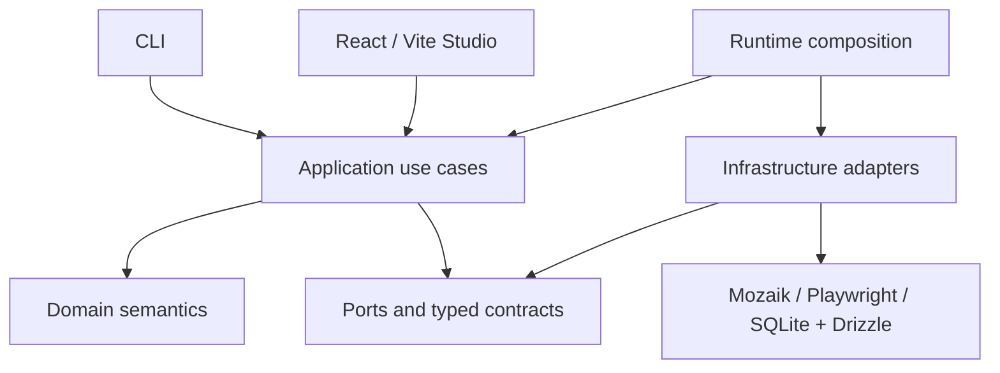

# Architecture

Read [PROJECT.md](PROJECT.md) for product semantics and implementation status.

## Confirmed direction

- TypeScript and Node.js, managed with npm without npm Workspaces.
- A CLI plus the existing React/Vite Studio. Do not relocate the CLI or restructure Studio without explicit authorization.
- Internal modular code under `packages/`, with hexagonal boundaries and dependency inversion where meaningful. Directories outside the implemented domain remain provisional scaffolding, not a finalized package design.
- Mozaik for concurrent multi-agent coordination and Playwright for browser automation.
- SQLite with Drizzle for local persistence.
- Typed semantic events and shared state for coordination and visibility.
- Explicit security policy enforcement and investigation/evidence management.
- Runtime composition connecting application behavior to replaceable infrastructure adapters.

These technology choices are intended direction. Mozaik, Playwright, SQLite, and Drizzle are not installed or integrated in the repository. Their APIs and integration requirements must be verified when implementation is requested.

## Dependency direction and responsibilities

Domain logic owns exploration and evidence semantics without importing browser, database, UI, orchestration-library, or model-provider implementations. Application use cases coordinate domain behavior through explicit ports where external capabilities are needed. Infrastructure implements those ports; it depends inward on their contracts. Runtime composition supplies concrete implementations.

CLI and Studio initiate use cases and present results. They must not become alternative owners of domain rules. Studio currently uses FSD with `@/` imports; retain its existing organization.

The diagram is conceptual. Studio-to-runtime transport and process boundaries are not selected. Arrows express dependencies or composition, not a finalized message flow or module tree.

## Required boundaries

**Coordination:** concurrent agents exchange typed semantic events and shared observations. Avoid coupling domain events to vendor payloads. Shared state needs explicit ownership and consistency rules before implementation.

**Security:** authorize tool actions at an enforced boundary before execution. LLM output and target content are untrusted. A profile, prompt, or shared observation cannot grant permissions. Potentially destructive actions against external software require explicit authorization.

**Investigation and evidence:** preserve the distinction between observations, suspicions, investigations, and confirmed findings. Evidence must be attributable to its source and context. Confirmation criteria and retention/redaction policies must be decided before presenting automated conclusions as confirmed.

**Persistence:** SQLite and Drizzle are infrastructure concerns. Domain logic must not depend on database rows or ORM types. Create schemas only for approved functionality.

**Composition:** runtime wiring selects adapters and supplies dependencies. Browser automation, storage, coordination, and any model integration should remain replaceable at meaningful boundaries without creating an interface for every class.

## Implemented domain foundation

`packages/domain/index.ts` is the public entry point. The module has no external imports, runtime dependencies, or independent package manifest. Its strict TypeScript configuration excludes browser and Node globals; tests use a separate configuration with Node types.

The domain contains branded, nonblank simulation/agent IDs; immutable profiles with personality, goals, and declared capabilities; a web execution environment classified by deployment stage; and immutable agent/simulation snapshots. Capability names are open declarations, not permissions or a closed tool catalog. Environment classification grants no authorization.

Lifecycle operations return new snapshots and raise `DomainError` with a stable code for invalid values, transitions, duplicate membership, unknown agents, empty starts, or unsettled participation at completion. Factories copy and freeze nested inputs. TypeScript consumers must use the factories and lifecycle operations; these types are not a decoder for untrusted external data.

| Model | Allowed transitions |
| --- | --- |
| Simulation | `created -> running/cancelled`; `running -> completed/failed/cancelled` |
| Agent | `ready -> running/cancelled`; `running -> completed/failed/cancelled` |

Terminal states cannot transition, including to themselves. Failure requires a nonblank reason. A simulation may be configured empty but cannot start empty. Its agent roster is fixed after creation and IDs must be unique within that roster. Starting changes only the simulation state and leaves agents ready. Each agent is activated explicitly through an aggregate update. Updates require a running simulation and a known member. An agent can remain running across multiple inference turns; a model answer is not a terminal participation event. The fixed domain roster is not the dynamic Mozaik participant registry, which can also contain humans and observers.

Simulation completion requires every agent to be terminal (`completed`, `failed`, or `cancelled`), rather than requiring successful goals. Goal descriptions carry no achievement verdict. An individual agent failure does not automatically fail the simulation: the caller explicitly chooses the session outcome. Cancelling or failing a simulation records cancellation for ready/running agents and preserves existing terminal outcomes. These pure snapshot operations cannot stop external work: future integration must enforce cancellation and handle late results, rather than equating a domain transition or `leave` with an abort. There is no pause, retry, automatic failure propagation, or global cross-simulation membership registry.

Root commands `npm run typecheck:domain` and `npm run test:domain` validate the module and run Node's built-in unit tests. `npm run check` includes both alongside existing Studio validation. No orchestration, policies, persistence, or application services are implemented.

## Proposed details and open questions

Outside the domain foundation described above, no internal package tree, exported API, event catalog, table schema, or independent package manifest is finalized. Decide these incrementally when needed:

- CLI entry point, configuration format, and runtime lifecycle.
- Studio transport, process topology, and event delivery/replay behavior.
- Mozaik integration, model-provider selection, concurrency limits, and cancellation.
- Shared-state consistency, investigation ownership, and duplicate handling.
- Confirmation criteria, evidence formats, retention, and sensitive-data redaction.
- Authorization representation, target isolation, and credential handling.

## Future capabilities

Adapters for non-web software and broader collaboration are future possibilities. Do not implement them speculatively. Current implementation is limited to the Studio and domain foundations described in PROJECT.md.
