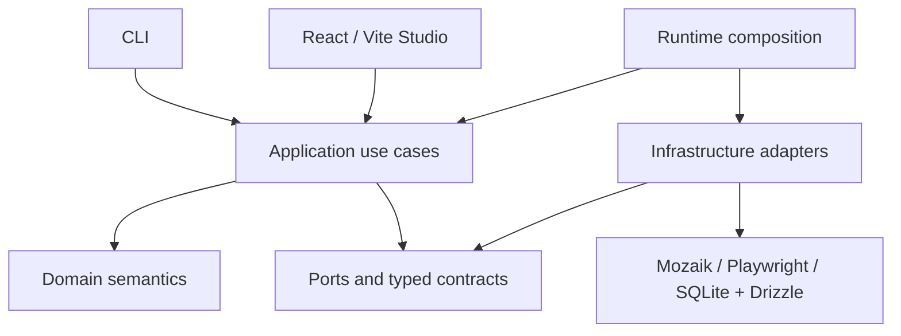

# Architecture

Read [PROJECT.md](PROJECT.md) for product semantics and implementation status.

## Confirmed direction

- TypeScript and Node.js, managed with npm without npm Workspaces.
- A CLI plus the existing React/Vite Studio. Do not relocate the CLI or restructure Studio without explicit authorization.
- Internal modular code under `packages/`, with hexagonal boundaries and dependency inversion where meaningful. Directories outside the implemented domain and contracts remain provisional scaffolding, not a finalized package design.
- Mozaik for concurrent multi-agent coordination and Playwright for browser automation.
- SQLite with Drizzle for local persistence.
- Typed semantic events and shared state for coordination and visibility.
- Explicit security policy enforcement and investigation/evidence management.
- Runtime composition connecting application behavior to replaceable infrastructure adapters.

These technology choices are intended direction. Mozaik, Playwright, SQLite, and Drizzle are not installed or integrated in the repository. Their APIs and integration requirements must be verified when implementation is requested.

## Dependency direction and responsibilities

Domain logic owns exploration and evidence semantics without importing browser, database, UI, orchestration-library, or model-provider implementations. Application use cases coordinate domain behavior through explicit ports where external capabilities are needed. Infrastructure implements those ports; it depends inward on their contracts. Runtime composition supplies concrete implementations.

CLI and Studio initiate use cases and present results. They must not become alternative owners of domain rules. Studio currently uses FSD with `@/` imports; retain its existing organization. Home and New simulation are separate page slices and share the header through `shared/ui/studio-header`. Studio uses “Users” for artificial-user selection, while internal participant and domain agent terminology remains unchanged. Page-local UserOption and UserAvatar components separate selection presentation, optional profile details, and reusable artwork. The participant catalog presents three approved behavioral profiles: Explorer (Raven), Impatient (Fox), and Beginner (Compass). Profile descriptions and motivations are presentation metadata backed by local prerendered artwork, without WebGL dependencies, runtime instructions, or mappings to domain agent factories. Avatar identity is separate from behavioral metadata; neither determines tools, skills, or permissions. See PROJECT.md for product semantics. The existing domain profile shape is unchanged; separate goal assignment, skill composition, and policy enforcement remain future implementation concerns. The setup editor owns an in-memory UI draft and pure field validation within its page slice; it does not instantiate domain simulations, emit lifecycle events, authorize actions, or persist configuration.

The diagram is conceptual. Studio-to-runtime transport and process boundaries are not selected. Arrows express dependencies or composition, not a finalized message flow or module tree.

## Required boundaries

**Coordination:** use Mozaik's concurrent runtime, semantic events, and situation handlers for reactive collaboration. Do not build a parallel inference/tool loop or assume a sequential agent pipeline. OFFSCRIPT owns domain rules and lifecycle decisions; the adapter maps these to runtime participants and events. Shared state needs explicit ownership and consistency rules before implementation. See [Mozaik alignment](MOZAIK.md) for the documented contracts and open guarantees.

**Security:** authorize tool actions at an enforced boundary before execution. LLM output and target content are untrusted. A profile, prompt, or shared observation cannot grant permissions. Potentially destructive actions against external software require explicit authorization.

**Investigation and evidence:** preserve the distinction between observations, suspicions, investigations, and confirmed findings. Evidence must be attributable to its source and context. Confirmation criteria and retention/redaction policies must be decided before presenting automated conclusions as confirmed.

**Persistence:** SQLite and Drizzle are infrastructure concerns. Domain logic must not depend on database rows or ORM types. Create schemas only for approved functionality.

**Composition:** runtime wiring selects adapters and supplies dependencies. Browser automation, storage, coordination, and any model integration should remain replaceable at meaningful boundaries without creating an interface for every class.

## Implemented domain foundation

`packages/domain/index.ts` is the public entry point. The module has no external imports, runtime dependencies, or independent package manifest. Its strict TypeScript configuration excludes browser and Node globals; tests use a separate configuration with Node types.

The domain contains branded, nonblank simulation/agent IDs; immutable profiles with personality, goals, and declared capabilities; a web execution environment classified by deployment stage; and immutable agent/simulation snapshots. Capability names are open declarations, not permissions or a closed tool catalog. Environment classification grants no authorization.

Lifecycle operations return new snapshots and raise `DomainError` with a stable code for invalid values, transitions, duplicate membership, unknown agents, empty starts, or unsettled participation at completion. Factories copy and freeze nested inputs. TypeScript consumers must use the factories and lifecycle operations; these types are not a decoder for untrusted external data.

| Model | Allowed transitions |
| --- | --- |
| Simulation | `created -> running/cancelled`; `running -> completed/failed/cancelled` |
| Agent | `ready -> running/cancelled`; `running -> completed/failed/cancelled` |

Terminal states cannot transition, including to themselves. Failure requires a nonblank reason. A simulation may be configured empty but cannot start empty. Its agent roster is fixed after creation and IDs must be unique within that roster. Starting changes only the simulation state and leaves agents ready. Each agent is activated explicitly through an aggregate update. Updates require a running simulation and a known member. An agent can remain running across multiple inference turns; a model answer is not a terminal participation event. The fixed domain roster is not the dynamic Mozaik participant registry, which can also contain humans and observers.

Simulation completion requires every agent to be terminal (`completed`, `failed`, or `cancelled`), rather than requiring successful goals. Goal descriptions carry no achievement verdict. An individual agent failure does not automatically fail the simulation: the caller explicitly chooses the session outcome. Cancelling or failing a simulation records cancellation for ready/running agents and preserves existing terminal outcomes. These pure snapshot operations cannot stop external work: future integration must enforce cancellation and handle late results, rather than equating a domain transition or `leave` with an abort. There is no pause, retry, automatic failure propagation, or global cross-simulation membership registry.

Root commands `npm run typecheck:domain` and `npm run test:domain` validate the module and run Node's built-in unit tests. `npm run check` includes both alongside existing Studio validation. No orchestration, policies, persistence, or application services are implemented.

## Implemented lifecycle contracts

`packages/contracts/index.ts` exposes version-1 lifecycle events, immutable simulation/agent summary DTOs, pure snapshot mappers, and explicit runtime validation. The module depends only on the domain public entry point and its own files; the domain does not depend on contracts. It has no independent package manifest or external runtime dependencies.

The envelope carries event identity, type, schema version, UTC timestamp, simulation identity, origin, correlation identity, and an event-specific summary payload. The origin is either the system or an originating agent; an affected agent is identified separately in its summary. The eight events cover started, completed, failed, and cancelled participation/session facts. They are not commands or Mozaik turn events.

See [CONTRACTS.md](CONTRACTS.md) for field definitions, validation, serialization, and public functions. IDs, statuses, and failure semantics reuse the domain; no domain source was changed. Parsed snapshots are detached and frozen. Version 1 rejects unknown fields, event types, unsupported versions, invalid timestamps, and inconsistent subject IDs/statuses.

Validation establishes message shape, not event truth, authorization, membership, valid lifecycle history, or actual interruption of external work. Events do not execute transitions, publish themselves, or confirm goal achievement. Investigations and their DTOs remain deferred until their domain rules are defined.

## Implemented observation foundation

The domain now includes branded observation/evidence identities and an immutable observation value with agent/simulation provenance, canonical UTC observation time, description, opaque location, and unique evidence references. An empty evidence list is allowed; references do not establish resource existence or a confirmed finding. The factory has no infrastructure dependencies, side effects, or lifecycle requirements.

Contracts expose `ObservationSummary` and `observation.created` through an opt-in `SemanticEvent` union and creation/parsing/serialization functions. Existing lifecycle entry points remain unchanged and reject observation events. The new event uses the existing version-1 envelope; validation checks matching simulation and agent-origin authorship. A system may record an observation while preserving its agent author. No existing payload schema changes, so existing lifecycle schemas remain version 1. See [OBSERVATIONS.md](OBSERVATIONS.md) for the field rules, compatibility boundary, and unresolved evidence/time guarantees.

Observations do not trigger investigations in this implementation. Domain values and contracts remain independent of Mozaik, Playwright, persistence, CLI, and Studio. Tests are included in the existing domain/contracts validation commands.

Root `npm run typecheck:contracts` and `npm run test:contracts` validate this module. `npm test` runs domain and contracts tests; `npm run lint` covers internal modules and Studio. The existing `npm run check` entry point includes all these checks and the Studio build, so the existing GitHub workflow validates this milestone without a second pipeline.

## Proposed details and open questions

Outside the domain and lifecycle contracts described above, no further internal package tree, exported API, event catalog, table schema, or independent package manifest is finalized. Decide these incrementally when needed:

- CLI entry point, configuration format, and runtime lifecycle.
- Studio transport, process topology, and event delivery/replay behavior.
- Mozaik adapter implementation, version selection, model-provider selection, concurrency limits, and actual cancellation. Documented API behavior and unproven guarantees are separated in [MOZAIK.md](MOZAIK.md).
- Shared-state consistency, investigation ownership, and duplicate handling.
- Confirmation criteria, evidence formats, retention, and sensitive-data redaction.
- Authorization representation, target isolation, and credential handling.

## Future capabilities

Adapters for non-web software and broader collaboration are future possibilities. Do not implement them speculatively. Current implementation is limited to the Studio, domain, and lifecycle contract foundations described in PROJECT.md.
