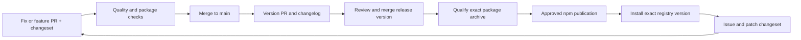

# Public launch plan: @nikelyh/offscript 1.0.0

## Status and release objective

This is an implementation/release plan, not an active publishing workflow. No release dependency, version change, npm publication, DNS change or website deployment is performed by this document. Preserve the existing feature scope for the hackathon; do not restart the broader roadmap.

Target package: `@nikelyh/offscript`, executable `offscript`, initial stable version `1.0.0`. Target public site: `https://offscript.nikelyh.tech`. The account must own or be authorized for the npm scope; GitHub owner and npm scope need not match.

At planning time, the root manifest is `offscript@0.0.0`, private, with no release workflow or Changesets dependency. README.md is empty. LICENSE contains Apache-2.0. The existing archive bundles compiled JavaScript, migrations and Studio; SQLite is native and Chromium requires separate installation. C1-C3 have corrective commits recorded in CONSOLIDATION.md; verify their relevant checks when qualifying a release rather than asserting all runtime gaps are closed.

Important product boundary: normal CLI browser mode still supplies deterministic inference. This is a working integration/demo mode, not proof of autonomous goal pursuit or profile-dependent reasoning. Decide and document the 1.0.0 claim before release. If demonstrating live model inference through an existing supported path, give exact verified configuration/commands and distinguish that path from default Studio execution. Do not add a fake provider setting, hide this limit, or claim hackathon points are guaranteed.

## 1. Scope freeze and judging evidence

| Hackathon criterion | Evidence to prepare |
| --- | --- |
| Useful and original — 30 | Concrete developer problem, one reproducible example, actual observations/results and limitations; explain artificial users versus scripted regression tests. |
| Mozaik parallel agents/shared state — 30 | A diagram and short run showing more than one agent active, separate identities, shared observations/investigation state and reactive collaboration through Mozaik. Trace to actual runtime code and real timestamps; do not manufacture parallelism in a graphic. |
| Runnable from README — 25 | Fresh-project install/run from the exact archive and published registry version, requirements, expected output, browser setup, target startup, cleanup and troubleshooting. |
| Clear README — 15 | Short product description, readable demo/architecture graphics, quick start, usage, explanation of Mozaik, limitations, documentation and license links. |

Freeze scope now, complete a baseline rehearsal before 1.0.0, then run a registry smoke test immediately after publishing. Post-release testing and patches supplement pre-release validation; they do not replace it. No full new browser/provider test campaign is authorized by this plan; arrange the relevant scope for the qualification task.

## 2. Public/private content cleanup — prepared first

Keep technical documentation, limitations, source and tests public. Untrack only personal Antigravity/context files and ignore future local artifacts according to [PUBLIC-CONTENT.md](PUBLIC-CONTENT.md). Confirm links still work from a fresh clone. Review history for actual secrets separately; untracking does not erase historical publication.

## 3. Define and validate the package artifact

In a preparation PR, rename the root package, make it publishable only when ready, and add description, Apache-2.0 license metadata, author as approved, repository/bugs URLs, keywords, engines, homepage, and publishConfig access public. Preserve the `offscript` bin and one root publishable package. Studio and the proposed docs app remain private independent installations; do not add workspaces or internal package manifests.

Use the existing files allowlist, refined against the actual import graph:

| Destination | Include |
| --- | --- |
| GitHub source | packages source/tests, Studio source/assets, scripts, lockfiles, public docs, CI, reviewable migration sources and metadata. |
| npm archive | offscript.mjs, clean dist runtime graph and CLI helpers, migrations, dist/studio assets/fonts, root manifest, README, LICENSE and required attribution/NOTICE material. |
| Documentation deployment | Only the independently built static site and its reviewed public assets. |

Do not ship project data, personal context, test reports, unused prior builds, node_modules, CI scripts or development-only application source in npm. Keep deterministic helpers that the shipped runtime actually imports; removing a file merely because its name says fixture can break the product. Review dependency/font/artwork attribution and preserve Apache-2.0 requirements.

The current distribution-assets script copies over existing output. Add a narrowly scoped clean distribution step before the release build, validating absolute targets under the checkout before recursive removal. This prevents accumulated hashed Studio assets from entering subsequent archives. Do not delete user project storage or clean arbitrary directories.

Build in a clean checkout, run required checks, then `npm pack`. Audit its file list/size, extract it, and run that exact archive from a separate project. Test help/version, studio with no-open, API access, supported execution/results, normal shutdown and persistence. Verify production installation needs neither TypeScript compilation nor Husky/Vite dev dependencies. Check Windows/macOS/Linux startup and supported Node versions proportionally, especially native SQLite and browser prerequisites.

Inspect Playwright's installed package/bin before documenting external browser installation: a transient `npx playwright` may select a different version than OFFSCRIPT's runtime. The release qualification must verify the exact supported installation command and binary compatibility. Never silently download browsers or start the target's npm scripts as part of install.

Keep one tested archive for publication, record its integrity, and avoid rebuilding a different artifact between smoke test and publish. Review npm lifecycle hooks when publishing an archive so they do not silently substitute another build.

## 4. README and graphics — before stable publication

Use the root README as the package README; a separate npm README is unnecessary. npm renders the README shipped with the package. Use absolute links/images that work on npm as well as GitHub; Mermaid can have a committed SVG fallback. See [npm README documentation](https://docs.npmjs.com/about-package-readme-files/).

Write the initial README around the verified public commands, with unpublished examples clearly labelled until release:

```sh
# Planned public entry, available after publishing the scoped package:
npm exec --yes --package=@nikelyh/offscript@1.0.0 -- offscript studio
# Equivalent one-shot invocation:
npx --yes @nikelyh/offscript@1.0.0 studio
# Optional local development dependency:
npm install --save-dev @nikelyh/offscript
npx offscript studio
```

Run from the target directory or pass --project. Explain Node/npm requirements, how to install the matching Chromium binary, starting the target separately, secure HTML entry and --no-open fallback, stored data location, execution mode, list/results/recover commands, provider costs if applicable, and known limits. A global install can be optional; it must not determine the project root.

Prepare these assets using synthetic data:

1. Brand/mascot hero and an actual Studio screenshot.
2. One architecture diagram: CLI/Studio → host/application → Mozaik, browser contexts and SQLite; arrows distinguish composition from data flow.
3. A short sequence diagram/recording of concurrent agents sharing an observation and investigating it. Label deterministic versus live behavior precisely.

Keep diagram source and SVG exports under docs/assets. Provide alt text, readable small-screen labels and a static alternative to animation. Include a short reproducible demo script/guide and expected output. Do not embed credentials, personal local paths or synthetic results presented as genuine discovery.

## 5. Versioning with Changesets — after artifact/README preparation

Recommended: install and pin @changesets/cli as a root dev dependency, configure one publishable package without workspaces, baseBranch main and public access. Verify package discovery selects only the root; private apps are not versioned/published. Changesets supports single-package repositories; see its [getting-started guide](https://changesets.dev/guide/getting-started).

Use changeset entries for user-visible package changes, including shipped Studio fixes. Documentation-site-only changes do not require a new CLI version. An initial reviewed major changeset can move 0.0.0 to 1.0.0; versioning must update the changelog and synchronize the root lockfile. Do not separately increment the same version through npm version and Changesets.

Future flow: feature/fix PR with changeset → CI/review → main → generated release PR → review/merge version and changelog → release job. Configure the Changesets action to create a release PR, not independently publish through a second pathway. Do not commit directly to main.



Bug fixes are patch releases (1.0.1, 1.0.2); new backward-compatible features are minor releases (1.1.0); breaking CLI/configuration/storage contracts require an explicit compatibility plan and major version where appropriate. Do not label every future change a patch merely to keep the sequence linear. Changesets separates versioning and publication; see [its release guide](https://github.com/changesets/changesets/blob/main/site/guide/versioning-and-publishing.md).

## 6. GitHub automation — one publication owner

Proposed workflows, to implement in a separate approved slice:

- Existing quality.yml: required checks and install/browser prerequisites.
- package-check.yml: clean build, archive allowlist/size inspection, separate-project package smoke tests and artifact/integrity upload. Treat artifact changes as reviewable output.
- release-version.yml: Changesets release PR only; minimal contents/pull-request write permissions, no npm credentials and no publication.
- release-publish.yml: a protected, maintainer-triggered release of the merged version commit on main. Reject version/tag mismatch, existing immutable versions or unqualified commits; serialize releases. Publish the qualified artifact, create v1.0.0 and GitHub release notes from the same commit. First stable release requires explicit maintainer approval.
- docs-deploy.yml: static-site validation/deployment, independent of npm versioning.

Use npm Trusted Publishing/OIDC from GitHub-hosted runners for ongoing publication, with the exact owner/repository/workflow/environment configured in npm. Node 24 with npm >=11.5.1 meets the documented tooling floor; grant id-token write only to the publisher. Provenance is generated by supported trusted publishing. Prefer no long-lived npm token; disable automatic package-manager caching in the privileged publishing job. Official references: [npm trusted publishers](https://docs.npmjs.com/trusted-publishers/) and [setup-node publishing guidance](https://github.com/actions/setup-node/blob/main/docs/advanced-usage.md).

Confirm account/scope access and registry availability before publication; neither is established by this plan. If a new package cannot yet configure its trusted publisher, use a separately authorized account-authenticated first release or a genuine release candidate on the next tag to bootstrap it; then verify OIDC before relying on it. Do not publish an empty placeholder just to reserve the name. Verify current npm setup at implementation time.

Do not publish from pull requests, run untrusted PR code with publishing permissions, expose secrets in logs, or grant npm privileges to dependency bots. A failed smoke test stops the release. If the version exists, inspect it rather than overwriting it or automatically bumping until something publishes.

Pin reviewed third-party actions to immutable commits in the privileged release workflows. Keep repository and npm workflow/environment identities synchronized. Tag, GitHub release and npm version must identify the same reviewed source, not a later branch head.

## 7. Documentation site — apps/docs

Recommended location: `apps/docs`, alongside apps/studio and outside packages. It has a private package.json, lockfile, build scripts and static output of its own; this is a justified independent web app, not a workspace or new internal module. Do not create it during planning.

Use Astro with Starlight for a static documentation site, subject to confirming its current requirements during implementation. Start with overview, getting started, concepts/profiles, Mozaik collaboration, architecture, CLI usage, limitations, troubleshooting and changelog links. Keep technical docs as source references; deliberately select what the site publishes rather than copying the entire docs tree automatically.

Reuse the raven/brand SVGs, local typography and semantic palette. Share pure visual tokens/assets through a small design-source boundary when implementing; do not import Studio routing, stores, API clients or runtime packages, and do not fork two diverging token definitions. Mascot motion remains restrained and respects reduced motion. The public site must never call the visitor's local host or expose simulation data by default.

Recommended deployment: GitHub Pages for static hosting, using a docs-only Actions build and the github-pages environment (pages write/id-token write only there). Configure custom-domain HTTPS and the DNS for offscript.nikelyh.tech after the build works; verify DNS ownership/settings before changes. Keep previews, production deploys and npm publishing separate. Another static host can replace Pages without altering the application/runtime.

Implementation references: [Starlight configuration](https://starlight.astro.build/reference/configuration/), [Astro styles](https://docs.astro.build/en/guides/styling/), and [GitHub Pages custom domains](https://docs.github.com/en/pages/configuring-a-custom-domain-for-your-github-pages-site/managing-a-custom-domain-for-your-github-pages-site). With an Actions-based Pages deployment, configure the domain in repository settings; a CNAME file alone does not configure it.

## 8. Launch order and patch operations

1. Freeze claims/scope; finish personal-context cleanup and confirm a public fresh clone works.
2. Prepare package identity/metadata, clean artifact build, README, graphics, changelog/versioning and package checks through PRs.
3. Rehearse installation from the exact tarball before stable publication. Optionally use a clearly public 1.0.0-rc prerelease if desired; it is not a private test channel.
4. Set up the npm account/trusted publisher and protected release workflow; prepare the docs site in parallel after content exists.
5. Publish 1.0.0 only after approval and qualification, then install that exact registry version in a clean project. Check npm metadata, executable, archive integrity, README and release links.
6. Deploy/verify the documentation site and replace planned links with verified public links before the hackathon submission. A successful docs deployment must not imply the local execution service is hosted there.
7. Collect concrete installation/runtime issues; add the smallest meaningful regression, fix on a branch, add a patch changeset, run required checks, merge the release PR and publish 1.0.1/1.0.2 through the same workflow.

Published versions are immutable. Keep known-good exact-version instructions; if a version is harmful, communicate/deprecate it and release a corrected version according to npm policy. Do not erase user databases or promise migration rollback. Qualify storage compatibility, default behavior and README examples before patches as well as after publication.

## Definition of launch-ready

The scoped package is installable, its CLI/Studio work from another project, the README steps have been rehearsed, Mozaik parallel/shared-state use is demonstrable, limits are public, the artifact contains no private context/data, license/attribution is correct, and the release/site workflows have named owners and explicit publication gates. No score or production-readiness guarantee follows merely from the 1.0.0 number.

## Preparation checkpoint (2026-10-31)

Package identity, the source/archive README, explanatory graphics, clean distribution output and bundled font licenses are prepared. The package remains private at 0.0.0 and unpublished. This checkpoint does not establish production readiness.

Historical checkpoint; the follow-up below supersedes the audit and evaluation status. The results below consolidate the completed verification reported in the development handoff. They were not rerun during this documentation-only update. Earlier installation failures are historical observations, not the final result of the isolated checks.

### 1. Installation and archive checks

- Clean `npm ci` passed in isolation for both the root package and `apps/studio`.
- The exact generated `.tgz` was installed in a separate project.
- `studio --no-open` started successfully and the API returned HTTP 200.
- Shutdown and removal of temporary access files were verified in-process using `process.emit('SIGINT')`. This check did not exercise a real terminal Ctrl+C.
- The `list` command and SQLite checks passed.

Earlier successful preparation checks included `npm pack`, `npm run build:local`, lint, server typechecking, migration validation and the deterministic Mozaik demo. Those checks do not establish autonomous goal achievement.

### 2. Probable cause, not proven

The probable cause of the earlier unnecessary SQLite rebuild is npm 11 script policy / lockfile metadata behavior. The root cause is not proven. The added `engines.npm` declaration and `allowScripts` settings must not be described as confirmed fixes. No further npm root-cause experiments are part of this checkpoint.

### 3. Consumer audit — OPEN blocker

The checkout reports **0 vulnerabilities only with the `package.json` overrides in effect**. The separate consumer installation of the `.tgz` reports **4 moderate vulnerabilities**. Root-level overrides do not establish that consumers receive the same dependency graph or audit result.

**Audit gate: not satisfied for consumers.** This blocker remains OPEN; no remediation was attempted as part of this documentation update. Do not use the checkout's zero result as a release clearance.

### 4. Remaining warnings and unrelated failure

- npm reports an `install-scripts` warning for `@nikelyh/offscript` (`prepare`), `@google/genai` and `protobufjs`.
- The failure at `evaluation.test.ts:48` is recorded as unrelated to the installation/audit work. It remains a failing check; it was not repaired or dismissed as passing.

### 5. Verification limits

The full browser suite was not executed. Successful installation, API startup and in-process SIGINT handling do not establish browser behavior, real terminal signal handling, cross-platform readiness or live autonomous exploration.

### 6. Delivery boundary and next step

This update changes the release record only. No commits to the C1-C3 branch, pushes, pull requests or npm publication were performed. Changesets, trusted publishing, release automation and registry qualification remain pending.

Next, review the existing release-preparation diff separately from C1-C3. In a subsequent scoped task, resolve the consumer audit blocker against a freshly packed artifact and address the unrelated failing check before release qualification. Publication must remain blocked until the applicable gates pass. Do not resume npm internals investigation or consumer audit remediation under this documentation-only task.


## Release-blocker follow-up (2026-10-31)

**Consumer audit gate: satisfied for the newly packed 0.0.0 artifact on this Windows environment.** This supersedes the historical OPEN audit status above; it is not a guarantee against future advisories or a declaration of complete release readiness.

- Replaced `@fastify/static` with its underlying `@fastify/send` 4.2.0 for the existing explicit Studio asset routes. This removes the unused glob-based file-discovery dependency chain. Removed the static-plugin override. The final solution uses the normal root `package-lock.json`; no shrinkwrap, bundled dependencies, consumer override or fork is required.
- A fresh project installed the exact new `.tgz` successfully. Its `npm audit --omit=dev --json` returned zero vulnerabilities, and `npm ls @fastify/send glob minimatch --all` exited successfully with only `@fastify/send` present. Consumer CLI version/list and an in-memory SQLite query also passed. Checkout production audit returned zero vulnerabilities.
- Corrected the evaluation test's brittle text assertion: a provisional assessment must retain a nonempty uncertainty explanation, rather than contain one particular phrase. The existing assertions for provisional confidence and rejection of confirmed-finding status remain. The focused evaluation passed, as did all six existing finding-assessment tests; no finding-classification production logic changed.
- Server and orchestration typechecks, lint, distribution build/pack, five health/security tests and the local-entry/static-asset test passed. The existing asset test now additionally checks JavaScript content/type, missing-file rejection and dotfile denial.
- The full browser suite was not executed. The earlier in-process SIGINT verification remains historical; shutdown/API checks were not repeated on the final artifact. No live model calls, publication, commits, pushes or PR creation occurred.
- The three install-scripts warnings remain: OFFSCRIPT prepare, @google/genai and protobufjs. npm 11 script policy / lockfile metadata remains only a probable cause of the earlier installation issue; no confirmed root cause is asserted.

Next: review and commit the bounded release changes on a work branch, run the required integration gates, then prepare 1.0.0 and an explicitly authorized npm publication. Automated release tooling is still pending and must not be claimed as implemented.


## First npm publication (2026-10-31)

`npm publish nikelyh-offscript-1.0.0.tgz --access public` completed successfully after browser-based account verification, reporting `+ @nikelyh/offscript@1.0.0`. npm warned that processing may take a few minutes. The first immediate registry lookup still returned 404, so public availability and registry installation were not established by that response; do not attempt to republish the same version.

The published archive has SHA-1 `02856dcd2e6a385596a7ce94b2703928bfe3b462` and SHA-256 `DF1B3FBC119746BD964B773A3BF1136F033D38593138B82F00FF46EEA8ECBF6D`. Its separate-project installation passed with zero audit findings and CLI version 1.0.0. The archive contains 161 entries and excludes personal agent context and credentials.

The matching Playwright Chromium/headless binaries were installed, then the complete `npm run check` passed, including browser tests, module checks, lint and Studio build. This supersedes earlier statements that the full browser suite was not executed. It remains deterministic integration validation, not live autonomous product validation. Installation script warnings remain as recorded above.

The package was published from the prepared local release working tree. No Git commit, push, PR, tag or GitHub Release was created by this publication. Consolidating the exact source and documentation through the contribution workflow remains pending.
